# slidemachina benchmark

13 November 2026. The same talk of 21 slides in the slidemachina of this commit and the latest reveal.js, Slidev and open-slide from npm, median of 5 runs.
The method is in [benchmark/](https://github.com/xfenix/slidemachina/tree/main/benchmark) of the main branch.

| | slidemachina 1.5.0 | reveal.js 6.0.2 | Slidev 53.1.0 | open-slide 2.3.2 |
|---|---|---|---|---|
| First slide on screen | 165 ms | 203 ms | 295 ms | 420 ms |
| Key press to screen update | 32 ms | 19 ms | 28 ms | 38 ms |
| Dev server to first slide | 1.22 s | 0.67 s | 5.18 s | 3.68 s |
| Production build | 0.82 s | 0.47 s | 3.90 s | 1.55 s |
| Build output size | 0.7 MB | 1.8 MB | 0.9 MB | 1.9 MB |
| PDF export | 1.5 s | 23.6 s | 5.7 s | — |
