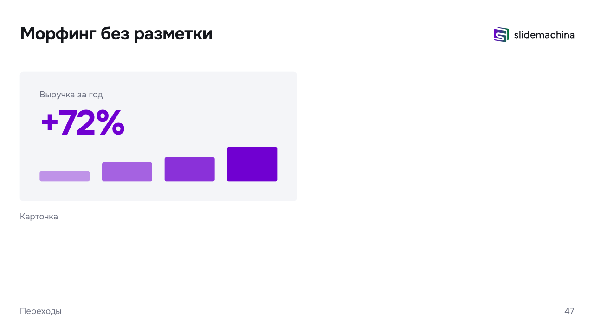
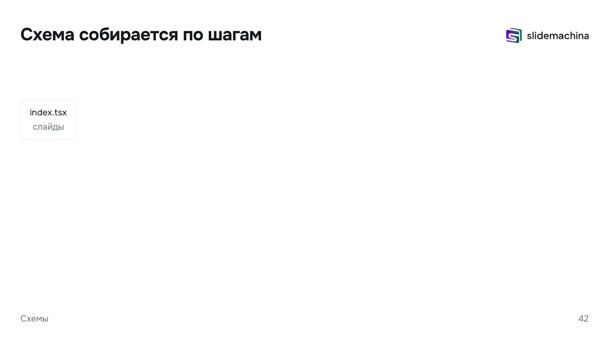
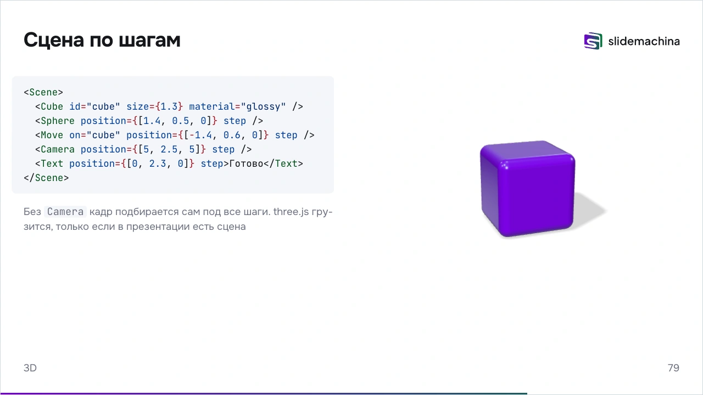
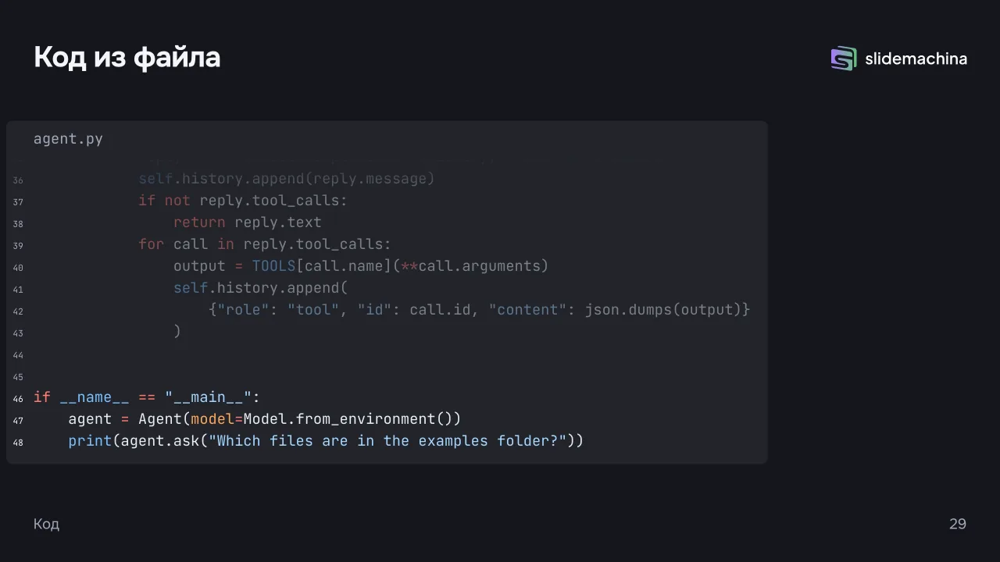
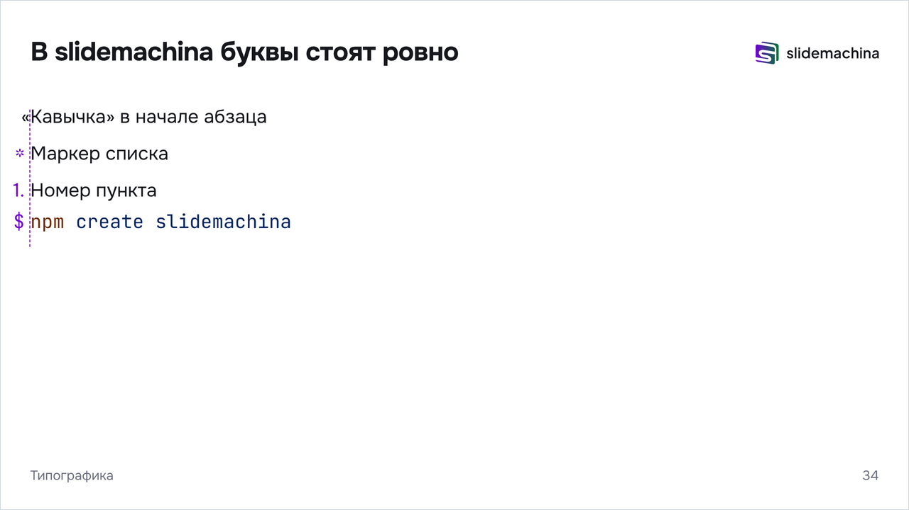
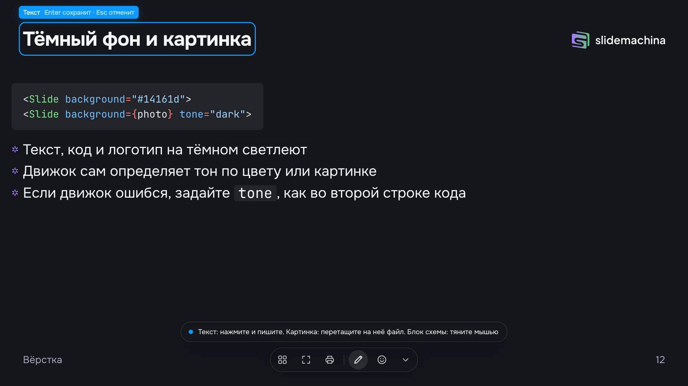
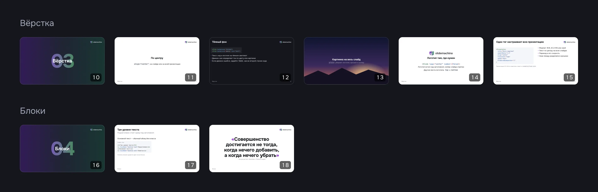
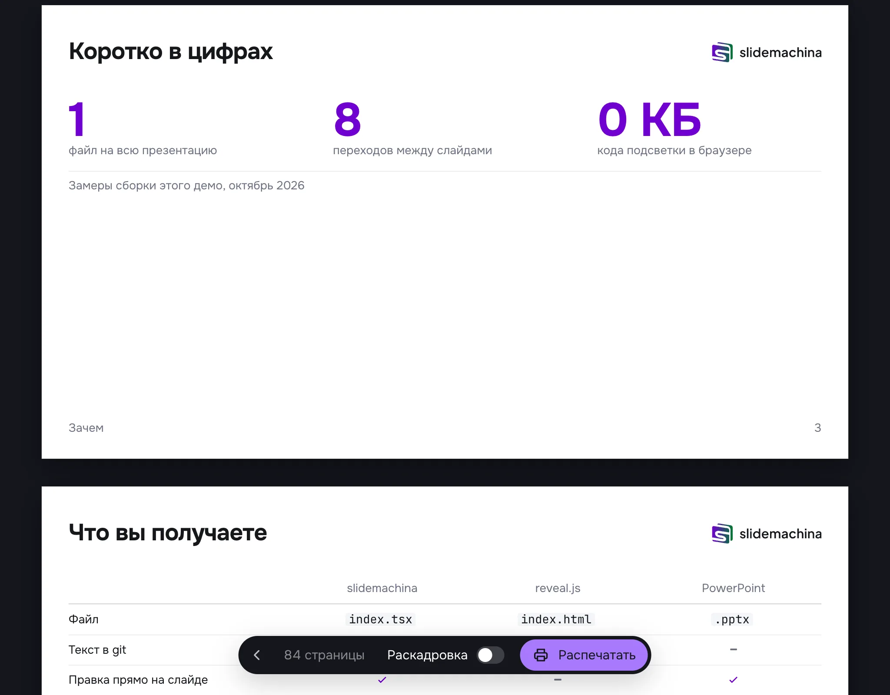
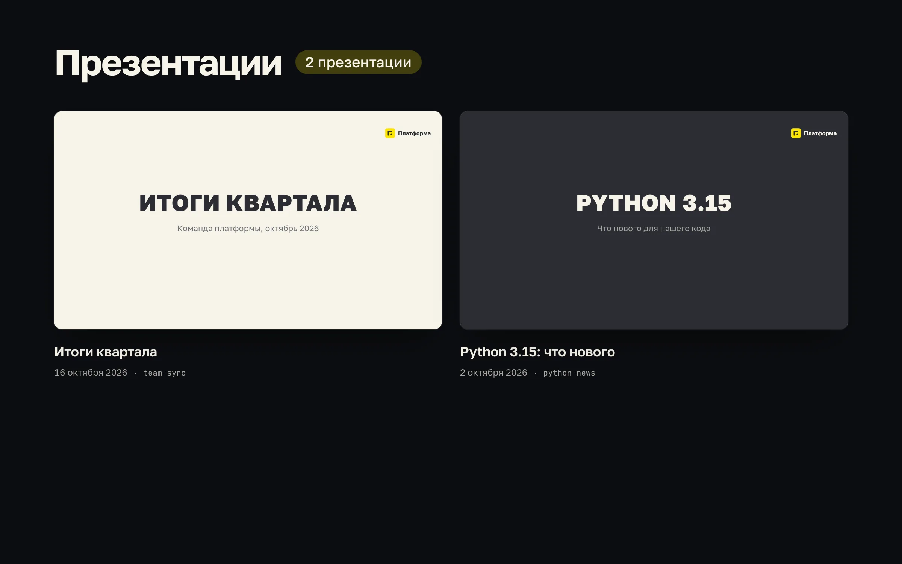
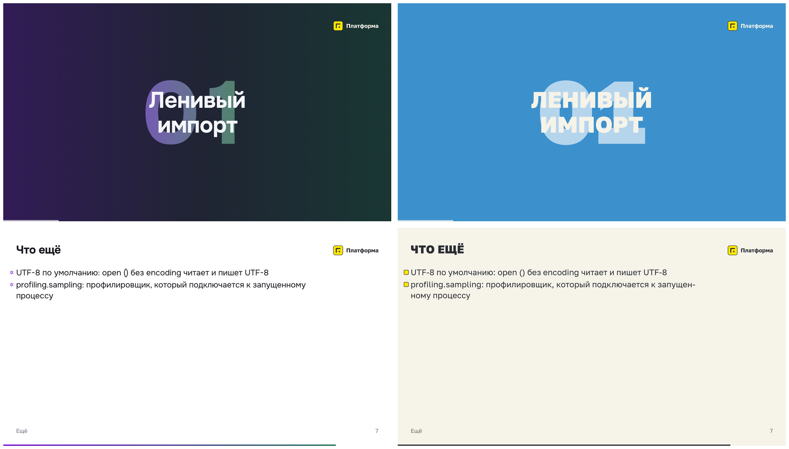

<p align="center">
  
  
</p>

<p align="center">
  <b>Presentations in React.</b><br>
  You write slides in one <code>index.tsx</code>.<br>
  One command builds them into an HTML file, a website, a PDF or PowerPoint.
</p>

<p align="center"><b>English</b> · <a href="README.ru.md">Русский</a></p>

<p align="center">
  <a href="https://www.npmjs.com/package/slidemachina"></a>
  
  
  
  
</p>

<p align="center">
  <a href="#why">Why</a> ·
  <a href="https://xfenix.github.io/slidemachina/">Live demo</a> ·
  <a href="#quick-start">Quick start</a> ·
  <a href="#features">Features</a> ·
  <a href="#your-own-theme">Your own theme</a> ·
  <a href="#for-agents">For agents</a> ·
  <a href="#how-it-compares">Comparison</a> ·
  <a href="#benchmark">Benchmark</a> ·
  <a href="docs/slidemachina.md">Docs (Russian)</a>
</p>

<p align="center">
  
</p>

## Why

- **Slides are React components.** You write a slide in JSX and keep your own components right in `index.tsx`, next to the slides. TypeScript checks the markup, git keeps the history, and changes go through review like any code.
- **The HTML opens anywhere.** The build is a single HTML file that opens from disk in any browser, with no network and nothing to install. The same build can go on a website. Quick Look on macOS shows the slides without opening the file.
- **PowerPoint is there when HTML is not allowed.** `--pptx` produces an editable copy: text, code and diagrams are separate objects, and steps become click animations. The file opens in PowerPoint and Google Slides.
- **Agents can work with it.** The whole presentation is one typed file, so Claude Code and other agents read and edit it easily. You can also leave a note for the agent by clicking on the slide.
- **Morphing works without markup.** Common elements, words and pieces of code morph between slides automatically. No `data-id` attributes needed.
- **Code highlighting costs 0 KB in the browser.** Shiki highlights at build time. The browser receives colored words, not a highlighting library.
- **Diagrams are code.** Write `<Diagram>`, `<Box>`, `<Arrow>` tags. ELK lays them out. Boxes morph between slides.
- **3D scenes on three.js.** `<Scene>`, `<Cube>`, `<Sphere>`, `<Light>`, `<Camera>` are all tags. three.js loads only when a scene exists.
- **Typography for Russian and English.** Quotes, dashes, non-breaking spaces. Hanging punctuation keeps the text edge straight in any browser and PDF.

## Quick start

```bash
npm create slidemachina   # asks: one presentation or a repository of talks
cd my-talk && npm install
npm run dev               # slides in the browser, changes show up at once
npm run build             # asks what to build
```

The template has 10 slides in Russian: a cover, a section, a list by steps, code, a diagram, morphing and a full-slide picture.
The demo in this repository shows every feature: `npm run demo`.

## What a presentation looks like

```tsx
import * as Machina from "slidemachina";
import logoPicture from "./images/logo.svg";

export default (
  <Machina.Presentation lang="en" logo={logoPicture} transition="auto" stepEffect="rise">
    <Machina.Slide cover>
      <h1>My talk</h1>
    </Machina.Slide>

    <Machina.Section title="How it works">
      <Machina.Slide>
        <h2>Three steps</h2>
        <ul data-steps>
          <li>An item appears on a key press</li>
          <li>Save the file and the slide updates on the same step</li>
        </ul>
      </Machina.Slide>

      <Machina.Slide>
        <h2>A diagram</h2>
        <Machina.Diagram>
          <Machina.Box id="browser">Browser</Machina.Box>
          <Machina.Box id="server">Server</Machina.Box>
          <Machina.Arrow from="browser" to="server" label="HTTP" step />
        </Machina.Diagram>
      </Machina.Slide>
    </Machina.Section>
  </Machina.Presentation>
);
```

A section adds a numbered cover slide, breadcrumbs and a group in the slide overview.
Styling uses plain tags and `machina-…` classes; the theme is CSS variables in `style.css` next to the slides.
Pictures go to `images/`, and TypeScript suggests components and their props.

## Features

<table>
  <tr>
    <td width="50%"></td>
    <td width="50%"></td>
  </tr>
  <tr>
    <td>Diagrams from tags: flowcharts with <code>Diagram</code> and sequence diagrams with <code>Sequence</code>. ELK lays out the boxes, they appear by steps and flow between slides.</td>
    <td>3D scenes with <code>Scene</code> on three.js. Shapes, light and camera are tags and follow the steps. three.js loads only when a scene exists.</td>
  </tr>
  <tr>
    <td></td>
    <td></td>
  </tr>
  <tr>
    <td>Code highlighted by Shiki at build time, so the browser runs none of its code. Code from a file, lines by steps, code morphing piece by piece.</td>
    <td>A typographer for Russian and English: quotes, dashes and non-breaking spaces. Hanging punctuation in text and code, in any browser and in PDF.</td>
  </tr>
  <tr>
    <td></td>
    <td></td>
  </tr>
  <tr>
    <td>Pictures and video fill the free space, the whole slide or float beside the text. On a dark background the text and the logo turn light automatically.</td>
    <td>QR codes with a logo, drawn as vectors. Memes and GIFs are one command away: <code>slidemachina meme</code>. A picture in <code>images/memes/</code> works by name, without an import: <code>&lt;Meme src="fine"&gt;</code>.</td>
  </tr>
</table>

### Layout

- Sections and subsections with numbered covers "02" and "02.1", breadcrumbs and groups in the overview. A section's own cover is the first `<Slide cover>` inside it.
- Covers aligned horizontally and vertically, with a picture on the left or on the right.
- A slide background can be a color, a picture, a video, a GIF or a web page. The engine detects whether the background is dark or light.
- Formats 16:9, 4:3, 16:10, 21:9 and 9:16. On screen the canvas grows with the window by up to a third, and the font size stays the same.
- The logo goes in one of five places: top right, top left, top center, above the heading or at the bottom. `plain` hides the logo, the breadcrumbs and the number.
- Free layout with `machina-freeform`, a block on top of the slide with `machina-pin`, and your own React components with the hooks `useSlide()`, `onEnter`, `onLeave` and `onChange`.

### Blocks

- A subtitle, a note, a source line.
- Columns, a big number with a caption, cards, bar charts.
- Tables and comparison tables with check marks and dashes.
- A quote with its author, and a one-phrase thesis on a colored slide.
- Pictures and video on the free space, on the whole slide or floating beside the text, with `fit="contain"` or `cover`.

### Steps and transitions

- Steps work on lists, tables, columns, part of a line, diagram boxes, code lines and scene objects. `data-steps` on a list makes every item a step.
- Six step effects: `rise`, `fade`, `scale`, `glitch`, `highlight` and `dim`. One effect for the whole presentation or a slide is `stepEffect`.
- 13 transitions: `morph`, `slide`, `fade`, `zoom`, `cube`, `flip`, `wipe`, `iris`, `blinds`, `mosaic`, `glitch`, plus `auto` and `none`. Speed is set for the whole presentation or for a slide.
- Morphing is on by default and finds pairs automatically: headings, pictures, cards, numbers, bars, diagram boxes, words in text and pieces of code.
- With reduced motion turned on in the system, there are no transitions.

### For the speaker

- The presenter window opens with <kbd>P</kbd>: the current slide, the next step, notes for each step in large type, a timer, a clock and how far ahead or behind you are. Either window can turn the slides, and it also works in an HTML file opened from disk.
- The slide overview opens with <kbd>Esc</kbd>. There is also a jump by number, a pause with a black screen, full screen and a progress bar.
- Hidden slides are skipped on stage and kept in print, PDF and PowerPoint. Put the details and theses for the copy you send after the talk there, and answers to audience questions.
- Keys work in the Russian layout too, and on a phone a swipe or a tap turns the slide.

### Build

- One HTML file with fonts and pictures inside. Quick Look on macOS shows the slides.
- A file behind a password, a folder for a website, a zip archive.
- PDF with a page per slide or per step, and a print view at `?print`.
- PowerPoint with editable text and diagrams and animated steps.
- Pictures are compressed to WebP, video is embedded as is.

## Tools

<table>
  <tr>
    <td width="58%"></td>
    <td>Edit right on the slide. Press E in <code>slidemachina dev</code>: text, pictures, diagram boxes and the slides themselves are written back to <code>index.tsx</code>.</td>
  </tr>
  <tr>
    <td></td>
    <td>The slide overview shows thumbnails by section. Esc or O opens it, Enter opens the chosen slide.</td>
  </tr>
  <tr>
    <td></td>
    <td>Print and PDF with a page per slide or per step: <code>slidemachina build --pdf</code> or print from the browser.</td>
  </tr>
  <tr>
    <td></td>
    <td>A repository of talks has a shared theme, a list with live covers sorted by date, and one build for all the talks.</td>
  </tr>
</table>

Also in `slidemachina dev`:
- a minimap of all slides on the right, toggled with <kbd>M</kbd>;
- the Meme panel with memegen templates, GIPHY GIFs or a picture from a link; the meme lands on a new slide;
- [Agentation](https://www.npmjs.com/package/agentation): click on a slide and write a note, and it goes to Claude Code with the place in the file, such as `index.tsx:42:7`;
- editing a `.tsx` file updates the slide without a reload, on the same slide and step.

## For agents

You can hand a presentation to an agent: it writes the slides, styles them for a brand and checks the result itself.

- Every new project gets `AGENTS.md`, `CLAUDE.md` and a Claude Code skill in `.claude/skills/slidemachina` from `npm create slidemachina`. They cover how to start a talk, how to style it and how to check it.
- `llms.txt` is a one-page reference to every component, class, step, transition and theme variable: `node_modules/slidemachina/llms.txt`.
- The rules of a clear talk come from Richard Mayer's 12 principles of multimedia learning and Miller's 7±2 limit of working memory. `slidemachina check` catches what can be measured: long lists, too much text, crowded diagrams, long code without steps, slides without a heading and pictures without `alt`. With `--json` it reports the place in the file and the slide number.
- `slidemachina shot 12.2` saves slide 12 after two steps as a PNG, so the agent sees the layout and not only the code.
- These are plain commands, not an MCP server. An agent already runs shell commands. An MCP server has to run next to it and adds its tool descriptions to the agent context; a command costs nothing until the agent calls it.
- In `slidemachina dev` a note on a slide goes to Claude Code through Agentation together with its place in the file.

```bash
npx slidemachina check --json   # [{ "file": "index.tsx", "line": 42, "slide": "7", "rule": "longList", … }]
npx slidemachina shot 7         # slide-7.png
```

## Build

Without flags, `slidemachina build` asks what to build.
In CI the flags add up: `slidemachina build --html --folder --pdf --pptx`.

| Flag | Result |
|---|---|
| `--html` | One HTML file with fonts and pictures inside. Opens from disk |
| `--protected` | The same file behind a password |
| `--folder`, `--zip` | A folder for a website, or the same folder zipped |
| `--pdf`, `--steps` | PDF with a page per slide or per step |
| `--pptx` | PowerPoint. Text, tables, code, pictures, diagram boxes and arrows are separate editable objects. Steps are click animations |
| `--hyperframes` | HyperFrames composition: a still frame per slide and step, with timing for video |
| `--no-hidden` | PDF, PowerPoint and HyperFrames without hidden slides. By default they are in |

### HyperFrames

Build a [HyperFrames](https://github.com/heygen-com/hyperframes) composition from your presentation:

```sh
npx slidemachina build my-talk --hyperframes --no-hidden
npx hyperframes preview dist/my-talk-hyperframes
npx hyperframes render dist/my-talk-hyperframes
```

The output folder contains `index.html` and `assets/`. Each slide and each revealed step becomes a lossless WebP frame at the presentation's canvas size. The HTML declares the canvas dimensions and clip timings; HyperFrames can seek forward or backward and render the frames to video. No HyperFrames dependency is added to your presentation.

Each frame lasts 5 seconds by default. To set the timing, put `hyperframes.json` next to `index.tsx` before building:

```json
{ "durations": [5, 2, 2, 8] }
```

One duration in seconds per frame, in presentation order, including the initial state before the first step. The array must match the frame count, and every duration must be positive and finite. The build reports the expected count if they differ. Hidden slides are included unless you pass `--no-hidden`.

By default, this export uses the print view: transitions are cut, video, GIF and 3D become still frames, and iframe backgrounds are omitted. Text and diagrams are part of the images. Add music, narration and other scenes in HyperFrames. Rebuilding replaces the output folder, so copy it before editing it there.

To keep native slide transitions, including morphing words, code and cards, add `motion: "native"` to `hyperframes.json`:

```json
{
  "durations": [2, 3, 5],
  "motion": "native",
  "fps": 30,
  "transitionDuration": 0.6
}
```

Build with the same `--hyperframes` command. Chrome runs the presentation's own transitions and captures lossless WebP frames. HyperFrames seeks those images by frame number, so seeking backward shows the same pictures. `motion.json` records the states, frame timings and captured animation names. No new dependencies or external rendering services are needed.

`durations` still has one entry per slide and revealed step, including the state before the first step. A transition occupies the start of the incoming state's duration; it does not extend the video. Each state needs at least one frame, and at least one hold frame must remain after a transition. Cumulative timings are rounded to the nearest output frame. `fps` defaults to 30 and accepts whole numbers from 1 to 60. Omit `transitionDuration` to use each transition's native duration. Render HyperFrames at the same frame rate, for example `npx hyperframes render dist/my-talk-hyperframes --fps 30`.

Native motion supports static slide content: text, code, cards, pictures and DOM diagrams. Animations between steps of the same slide are not captured; steps remain still states. Video, iframe and 3D content are rejected. Animated pictures, custom timers and endless animations are outside this mode's capture guarantees. Transitions are baked into images, so edit the source presentation and rebuild to change them. More transitions and higher frame rates increase export time and asset size. Omit `motion` or set it to `"still"` to use the default export.

## Your own theme

The same presentation in the engine's theme and in a brand theme.
The slide markup did not change, only the CSS did.

<p align="center">
  
</p>

The theme lives in `style.css` next to `index.tsx`.
Want everything in one file? Put the same CSS right into `index.tsx` with `Machina.css`: Tailwind, `@import` and `url()` work there too, and an edit shows up at once.
You can also import any CSS file. Use one way or mix them.

```tsx
Machina.css`
  :root { --accent-color: #e8574c; }
  [data-slide] h2 { text-transform: uppercase; }
`;
```

Editors with styled-components support highlight the CSS inside `css` templates: in VS Code that is the vscode-styled-components extension.
This is how the brand theme from the picture is built; its full version is [`examples/theme/yellow-brand.css`](examples/theme/yellow-brand.css).

**1. Colors and backgrounds.** Variables set almost everything. Change a variable and every slide follows.

```css
@import "tailwindcss";

:root {
  --slide-background: #f6f3e9;   /* regular slides */
  --section-background: #fee600; /* section covers */
  --dark-background: #2b2d33;    /* dark slides */
  --text-color: #2b2d33;
  --muted-color: #6e6f73;        /* captions, breadcrumbs, the slide number */
  --accent-color: #2b2d33;       /* bullets, links, numbers */
  --second-accent-color: #2b2d33;
  --code-background: #ece7d8;
}
```

**2. Font.** Put the font file next to the slides and add it with `@font-face`.

```css
@font-face {
  font-family: "Golos Text Variable";
  font-weight: 400 900;
  src: url("./fonts/golos-text.woff2") format("woff2-variations");
}

:root {
  --font-text: "Golos Text Variable", system-ui, sans-serif;
  --font-heading: var(--font-text);
  --heading-weight: 800;
}
```

**3. Headings and bullets.** Plain CSS changes anything the variables do not cover; it is stronger than the engine's styles.

```css
[data-slide] :is(h1, h2) {
  text-transform: uppercase;
  letter-spacing: 0.01em;
}

/* A square bullet instead of the engine's star */
[data-slide] ul > li:before {
  clip-path: none;
  border-radius: 2px;
  background: #fee600;
  box-shadow: 0 0 0 2px var(--text-color);
}
```

**4. Section covers.** No gradient and no grain, and a white section number.

```css
:root {
  --section-texture: none;
  --section-glow-strength: 0%;
  --section-number-start-color: #ffffff;
  --section-number-end-color: #ffffff;
}
```

**5. Light and dark slides, and the logo.** A slide turns dark from its `background`: a color, a picture or a video. The engine measures the tone and switches the text to the `-on-dark` colors; `tone` corrects it.
The logo follows the tone in three ways: one file the engine whitens on dark slides, a pair of files, or your own component. A component gets `dark` and draws itself in any color.

```tsx
// One file: on dark slides it turns white through --logo-filter-on-dark.
<Machina.Presentation logo={logoPicture}>

// Two files: the engine picks one by the tone of the slide.
<Machina.Presentation logo={{ light: logoPicture, dark: logoOnDarkPicture }}>

// Your own logo: an SVG in the brand colors that adapts to the slide.
const BrandLogo = ({ dark }: { dark: boolean }) => (
  <svg viewBox="0 0 120 32" fill={dark ? "#fee600" : "#2b2d33"}>…</svg>
);
<Machina.Presentation logo={BrandLogo}>

// A dark slide: a color or a picture; tone="dark" if the engine guesses wrong.
<Machina.Slide background="var(--dark-background)">
```

**6. Motion, logo place and format.** These are props of `Presentation`, and a single `Slide` can override them.

```tsx
<Machina.Presentation
  logo={{ light: logoPicture, dark: logoOnDarkPicture }}
  aspectRatio="4:3"
  transition="glitch"
  stepEffect="fade"
  speed="fast"
>
```

**7. One slide of its own.** `className` on `Slide` and Tailwind classes right in the markup.

```tsx
<Machina.Slide className="[--hanging-punctuation:0]" background="var(--accent-soft-color)">
  <p className="machina-thesis text-(--accent-color)">One thought, large</p>
</Machina.Slide>
```

<details>
<summary><b>Every place where the look is set</b></summary>

| What | Where |
|---|---|
| Colors | `--accent-color`, `--second-accent-color`, `--text-color`, `--muted-color`, and the backgrounds `--slide-background`, `--dark-background`, `--section-background`. Text colors have `-on-dark` versions for dark slides |
| Fonts | `--font-text`, `--font-heading`, `--font-code`, `--heading-weight`. Add your own font with `@font-face` in the same `style.css` |
| Font sizes | Four levels: `--secondary-text-size` 28, `--text-size` 40, `--heading-size` 56, `--display-size` 112. Other sizes follow from them |
| Margins and gaps | `--frame-padding` on the sides and bottom, `--frame-top` at the top, `--heading-gap` under the heading, `--block-gap` between blocks, `--columns-gap` between columns |
| List bullets | `[data-slide] ul > li:before` and `--list-bullet-indent` |
| Section covers | `--section-background`, `--section-number-start-color`, `--section-number-end-color`, `--section-number-size`, `--section-texture`, `--section-glow-strength`. Or your own `<Slide cover>` first in the section |
| Motion | `transition` and `speed` on `Presentation` or `Slide`, durations `--transition-duration` and its neighbors, the curve `--transition-easing` |
| Steps | `stepEffect` on `Presentation` or `Slide`: `rise` (default), `fade`, `scale`, `glitch`, `highlight`, `dim`. `data-step-effect` on an element wins |
| Progress bar | `--progress-color`, `--progress-color-on-dark`, `--progress-height`, `progress={false}` on `Presentation` |
| Format | `<Presentation aspectRatio="4:3">`, `16:9` by default. Thumbnails, PDF and PowerPoint use this format; on screen the slide grows with the window by up to a third |
| Breadcrumb separator | `<Presentation breadcrumbsSeparator="/">`, `›` by default |
| Tab icon | `<Presentation favicon={favicon}>` with `import favicon from "./favicon.svg"`, the slidemachina mark by default |

- The logo is `logo` on `Presentation`: a file, `{ light, dark }` for light and dark slides, or a component. A component gets `dark={true}` on dark slides. The engine's own logo is `logo={Machina.SlidemachinaLogo}`.
- The logo position is `logo` on `Slide`: `"top-right"` (default), `"top-left"`, `"top"`, `"center"` above the heading, `"bottom"` or `false`.
- A dark slide is `background` on `Slide`, a color or a picture. The engine detects the tone; `tone` corrects it.
- A shared theme for several talks is `theme/style.css` in a repository of presentations. A talk's own theme is stronger.
- A theme for some of the talks is a CSS file imported in `index.tsx`: `import "../theme/brand.css"`.
- CSS right in `index.tsx` is `Machina.css` with a template, the same as `style.css`. `${…}` does not work in it: use CSS variables.

Every variable is described in the "Тема" section of [docs/slidemachina.md](docs/slidemachina.md) (in Russian).

</details>

## How it compares

Other tools help you make a beautiful slide.
slidemachina helps you give a talk people follow: it keeps lists, text and diagrams within Miller's 7±2 and follows Richard Mayer's 12 principles of multimedia learning.
The second rule is minimal markup. A slide is plain tags: no wrappers, ids or coordinates. Steps, layout and morphing come from the engine.

**✅ built in · 🟡 partial, plugin or DIY · ❌ nothing**

| | slidemachina | reveal.js | Slidev | open-slide |
|---|---|---|---|---|
| A clear talk | ✅ `check` counts list items, words, diagram boxes, code lines and sections. The agent skill follows Mayer's principles | ❌ | ❌ | 🟡 the skill asks how dense the text should be — nothing checks it |
| Markup | ✅ **TSX — plain React components, TypeScript checks the markup.** Know React — know slidemachina | HTML: a `<section>` per slide | Markdown with Vue components | React, but a fixed 1920×1080 canvas: absolute pixels, inline styles |
| Styling | ✅ **one `style.css`: theme variables, any selector, plain CSS or Tailwind. No theme packages** | CSS or Sass theme files | 🟡 a theme is an npm package with Vue layouts — restyling means writing your own theme — plus UnoCSS classes | Inline styles in every page. A theme is a Markdown file the agent copies into the slides |
| Markup per slide | ✅ `<Slide>`, an `h2` and plain tags. One `data-steps` for a whole list, no ids for morphing | `<section>`, `class="fragment"` on every element, `data-id` on morphing pairs | Markdown and frontmatter, `v-click` on every element, the layout named in frontmatter | Tags with inline styles and pixel coordinates, `<Step>` and `<MorphElement>` wrappers |
| Sections | ✅ `Section`: a numbered cover, groups in the slide overview | 🟡 nested `<section>` become vertical slides | ❌ | ❌ |
| Breadcrumbs | ✅ **on every slide, built from the sections by themselves: the hierarchy of the talk is always visible and leads the story** | ❌ | ❌ | ❌ |
| Steps | ✅ **the basic move of every good talk: one `data-steps` on a list, table or columns; one `stepEffect` styles all steps** | `class="fragment"` on every element | `v-click` on every element | `<Step>` around every element |
| Morphing | ✅ on by default: shared elements, words and pieces of code are matched automatically | 🟡 `data-auto-animate` on both slides, pairs through `data-id` | 🟡 code only, through `magic-move` | 🟡 `MorphElement` with the same `id` on both pages |
| Code highlighting | ✅ Shiki at build time: 0 KB of highlighting code in the browser, lines by steps | 🟡 highlight.js runs in the browser on every load | Shiki, live editing in Monaco | ❌ |
| Diagrams | ✅ flowcharts and sequence diagrams from tags, laid out by ELK; arrows morph between slides | 🟡 Mermaid through a third-party plugin, no morphing | 🟡 Mermaid, no morphing | ❌ |
| 3D scenes | ✅ `Scene` on three.js: shapes, light and camera are tags and move by steps | ❌ | ❌ | ❌ |
| Hanging punctuation | ✅ **quotes and brackets hang off the edge of the text, like in a book; bullets, code and line numbers hang too** | ❌ | ❌ | ❌ |
| Typographer | ✅ Russian and English: dashes, quotes, non-breaking spaces | ❌ | ❌ | ❌ |
| Floating images | ✅ **`float="left"` / `"right"`: text wraps around a picture or a meme** | ❌ | ❌ | ❌ |
| QR codes | ✅ **`<QR value="…">`: a vector code, your logo in the middle, its own color and caption. No generator site, no picture to redo when the link changes** | ❌ a picture from a generator site | 🟡 a community add-on or a picture from a generator site | ❌ a picture from a generator site |
| Memes | ✅ `slidemachina meme "this is fine"`: memegen templates and GIPHY GIFs; captions are editable text; `src="fine"` takes a local picture | ❌ a picture with the text baked in | ❌ a picture with the text baked in | ❌ a picture with the text baked in |
| Export | ✅ **one HTML file · password-protected HTML · website folder · zip · PDF per slide · PDF per step · PowerPoint with editable objects and step click animations · HyperFrames for video — the widest range of all** | 🟡 PDF through the browser's print dialog, nothing else | 🟡 website, PDF (per click with a flag), PNG, PPTX as screenshots — the text is not selectable | 🟡 website, PDF, PPTX with native objects |
| One HTML file | ✅ **an export, not a trick: fonts, pictures and scripts inside one file; opens from disk, Quick Look on macOS shows the slides** | ❌ a folder of files | ❌ a folder of files | ❌ a folder of files |
| Print to PDF from the deck | ✅ **press ⌘P / Ctrl+P in any presentation: the built-in print version gives a clean PDF, hidden slides included** | 🟡 a print stylesheet behind the `?print-pdf` parameter | 🟡 PDF only through the CLI export | ❌ |
| Password protection | ✅ `--protected`: the file is encrypted, the password is asked for or taken from `SLIDEMACHINA_PASSWORD` | ❌ | ❌ | ❌ |
| Editing | ✅ in a code editor and on the slide, written back to `index.tsx` | In a code editor | In a code editor and a Markdown panel | Comments on the slide, an agent applies them |
| Presenter window | ✅ notes, timer, next slide, next step, notes per step | Notes, timer, next slide | Notes, timer, next slide, drawing | Notes, timer, next slide |
| For agents | ✅ `llms.txt`, a skill, CLI commands: `check` for the rules of a clear talk, `shot` for a picture of a slide. No MCP server | ❌ | 🟡 an MCP server in `slidev dev` occupies agent context | 🟡 skills for writing and editing, an agent panel in the browser |
| Many talks | ✅ a repository: a shared theme, a list with covers, one build for all | ❌ each one on its own | 🟡 themes as npm packages | 🟡 decks in one workspace, shared Markdown themes |
| Hidden slides | ✅ `<Slide hidden>`: skipped on stage, kept in print, PDF and PowerPoint — the copy people get after the talk | 🟡 `data-visibility="hidden"` removes the slide everywhere, PDF too | 🟡 `hide: true` drops the slide from the deck and the export | ❌ |
| Screenshot for agent | ✅ `slidemachina shot 12.2`: one slide at a given step, in a second | ❌ | 🟡 `slidev export --format png`: the whole deck | ❌ |

Speed is in the [benchmark](#benchmark) below: it is measured again every week.

### 🟢 Only in slidemachina

- ✅ **QR codes and memes** — components with editable captions, not pictures from generator sites
- ✅ **Hanging punctuation** — book-quality typography nobody else does
- ✅ **Breadcrumbs** — the structure of the talk on every slide
- ✅ **Export to one HTML file** — even password-protected; the others give a folder
- ✅ **The widest export range** — PDF per slide and per step, editable PowerPoint with step click animations, HyperFrames for video
- ✅ **Floating images** — text wraps around pictures and memes
- ✅ **Hidden slides** — skipped on stage, kept in the handout
- ✅ **Agent commands** — `check` for the rules of a clear talk, `shot` for a slide picture

### 🔴 What we don't have

Honest gaps, and the way we close them:

- **Live code editing on the slide** — Slidev runs Monaco in the browser · we edit the code in the source and the slide hot-reloads
- **Draggable elements** — Slidev's `v-drag` · we place pictures and memes with `float` and columns
- **Drawing and a pointer over slides** — Slidev, Quarto · not yet
- **Formulas** — LaTeX in Slidev and Quarto · not yet
- **Phone remote, audience view, scroll reading, image lightbox** — reveal.js and Slidev · not yet
- **A visual editor in the browser** — open-slide: comment pins, an assets manager, an agent panel · we edit right on the slide, changes write back to `index.tsx`
- **Free-form wow pages** — open-slide pages are hand-positioned pixel React · the engine lays our slides out by rules, and that is why they stay readable
- **Markdown syntax** — none, on purpose: components and plain tags customize deeper than Markdown with frontmatter and layouts
- **An MCP server** — Slidev and open-slide ship one · we ship a skill and CLI that stay out of the agent's context

Pick reveal.js for the largest set of plugins and plain HTML.
Pick Slidev if you write in Markdown and Vue, or need drawing on slides and formulas.
Pick open-slide if an agent writes the slides and you only leave comments.

## Benchmark

<p align="center">
  <a href="https://github.com/xfenix/slidemachina/tree/benchmark"></a>
</p>

The same talk in the latest versions of all four tools from npm.
CI measures it after every release and every Monday, and the picture updates by itself.
Green: slidemachina is the best. Red: it is behind, and we are working on it.
The method is in [benchmark/](benchmark/), the numbers are in the [benchmark branch](https://github.com/xfenix/slidemachina/tree/benchmark).

## Development

```bash
npm install
npm run demo     # the demo with every feature
npm run check    # TypeScript, Oxlint and module boundaries
npm test         # integration tests on Playwright
```

How the engine works, the decisions behind it and its limits are in [docs/slidemachina.md](docs/slidemachina.md) (in Russian).
The rules for the code are in [AGENTS.md](AGENTS.md).

## License

[MIT](LICENSE)
