# slidemachina benchmark

18 November 2026. The same talk of 21 slides in the slidemachina of this commit and the latest reveal.js, Slidev and open-slide from npm, median of 5 runs.
The method is in [benchmark/](https://github.com/xfenix/slidemachina/tree/main/benchmark) of the main branch.

| | slidemachina 1.5.0 | reveal.js 6.0.2 | Slidev 53.1.0 | open-slide 2.3.2 |
|---|---|---|---|---|
| First slide on screen | 130 ms | 137 ms | 250 ms | 238 ms |
| Key press to screen update | 32 ms | 16 ms | 22 ms | 27 ms |
| Dev server to first slide | 0.83 s | 0.46 s | 3.54 s | 2.66 s |
| Production build | 0.81 s | 0.33 s | 2.41 s | 1.04 s |
| Build output size | 0.7 MB | 1.8 MB | 0.9 MB | 1.9 MB |
| PDF export | 1.0 s | 22.9 s | 3.7 s | — |
