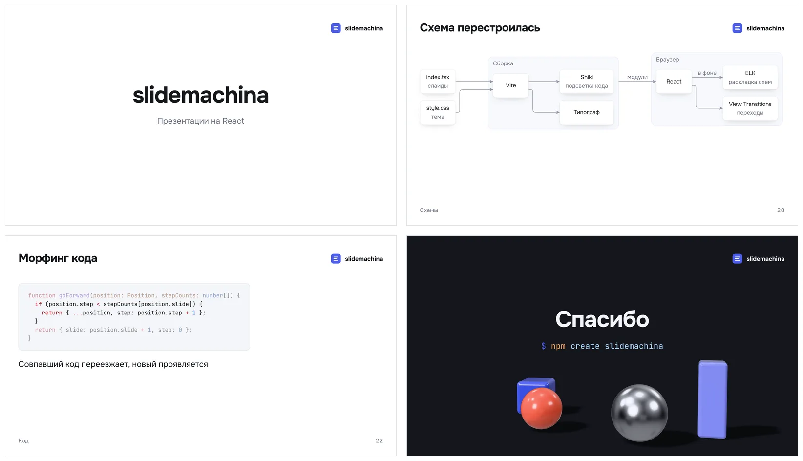

# slidemachina

Презентации на React. Слайды пишутся в одном `index.tsx`, а собираются одной командой: в HTML-файл, папку для сайта или PDF.



## Чем лучше reveal.js

| | reveal.js | slidemachina |
|---|---|---|
| Разметка | HTML: `<section>` в `index.html` | JSX в `index.tsx`. TypeScript подсказывает компоненты и их свойства |
| Разделы | Вложенные `<section>` — это вертикальные слайды. Хлебных крошек и обложек разделов нет | `Section` по желанию: обложка раздела с номером, хлебные крошки, группы в навигаторе. Обложку можно заменить своим слайдом или убрать |
| Шаги | `class="fragment"` на каждом элементе | `step` на списке, таблице, колонках, части схемы или сцены |
| Морфинг | `data-auto-animate` на обоих слайдах, пары через `data-id` | Включён по умолчанию. Общие элементы, слова и куски кода находятся сами |
| Подсветка кода | highlight.js работает в браузере | Shiki при сборке: кода подсветки в браузере 0 КБ |
| Схемы | Mermaid сторонним плагином | `Diagram` и `Sequence` с автораскладкой ELK. Блоки появляются по шагам и перетекают между слайдами |
| 3D | нет | `Scene` на three.js. Загружается, только если в презентации есть сцена |
| Типограф | нет | Кавычки, тире и неразрывные пробелы для русского и английского |
| Сборка | Сборщик настраиваете сами | Один HTML-файл со шрифтами и картинками внутри, папка, zip, файл под паролем, PDF |
| PDF | Открыть `?print-pdf`, распечатать из браузера | `slidemachina build --pdf` или печатная версия в браузере |
| Правка | В редакторе кода | Ещё и на слайде: текст, картинки и блоки схем пишутся обратно в `index.tsx` |
| Много докладов | Каждый сам по себе | Репозиторий: общая тема, список с обложками, сборка всех сразу |

## Как выглядит презентация

```tsx
import * as Machina from "slidemachina";
import logoPicture from "./images/logo.svg";

export default (
  <Machina.Presentation title="Доклад" lang="ru" logo={logoPicture}>
    <Machina.Slide cover>
      <h1>Доклад</h1>
    </Machina.Slide>

    <Machina.Section title="Как устроено">
      <Machina.Slide>
        <h2>Три шага</h2>
        <Machina.List step>
          <li>Пункт появляется по нажатию</li>
          <li>Сохранили файл — слайд обновился на том же шаге</li>
        </Machina.List>
      </Machina.Slide>

      <Machina.Slide>
        <h2>Схема</h2>
        <Machina.Diagram>
          <Machina.Box id="browser">Браузер</Machina.Box>
          <Machina.Box id="server">Сервер</Machina.Box>
          <Machina.Arrow from="browser" to="server" label="HTTP" step />
        </Machina.Diagram>
      </Machina.Slide>
    </Machina.Section>
  </Machina.Presentation>
);
```

Раздел даёт слайд-обложку, хлебные крошки и группу в навигаторе. Раздел внутри раздела становится подразделом, в крошках они идут через `›`. Другой разделитель задаёт `<Presentation breadcrumbsSeparator="/">`. Стиль — в `style.css` рядом, картинки — в `images/`.

## Быстрый старт

Так это будет работать после публикации в npm:

```bash
npm create slidemachina   # спросит: одна презентация или репозиторий
cd my-talk && npm install
npm run dev               # слайды в браузере, правки видны сразу
npm run build             # спросит, что собрать
```

Пока пакетов в npm нет, презентации запускаются из этого репозитория: положите папку с `index.tsx` рядом с `examples/` и выполните `npx slidemachina dev <папка>`.

Флаги сборки для CI складываются: `slidemachina build --html --folder --pdf`.

| Флаг | Результат |
|---|---|
| `--html` | Один HTML-файл, всё внутри. Открывается с диска |
| `--protected` | Тот же файл под паролем |
| `--folder`, `--zip` | Папка для сайта или она же в архиве |
| `--pdf`, `--steps` | PDF: страница на слайд или на каждый шаг |

## Своя тема

Тема — это CSS-переменные в `style.css` рядом с `index.tsx`. Поменяли переменную — поменялись все слайды.

```css
@import "tailwindcss";

@font-face {
  font-family: "Golos Text";
  font-weight: 400 900;
  src: url("./fonts/golos-text.woff2") format("woff2-variations");
}

:root {
  --accent-color: #e8574c;        /* маркеры, ссылки, номера разделов, числа */
  --slide-background: #fbfaf7;    /* фон обычного слайда */
  --dark-background: #15161b;     /* фон тёмных слайдов */
  --section-background: #1d2233;  /* фон обложек разделов */
  --font-text: "Golos Text", system-ui, sans-serif;
}
```

| Что меняем | Где |
|---|---|
| Цвета | `--accent-color`, `--text-color`, `--muted-color`, фоны `--slide-background`, `--dark-background`, `--section-background` |
| Шрифты | `--font-text`, `--font-heading`, `--font-code`. Свой шрифт — через `@font-face` в том же `style.css` |
| Кегли | Четыре уровня: `--secondary-text-size` 28, `--text-size` 40, `--heading-size` 56, `--display-size` 112. Остальные размеры берутся от них |
| Рамка слайда | `--frame-padding` по бокам и снизу, `--frame-top` сверху, `--heading-gap` под заголовком |
| Обложки разделов | `--section-background`, `--section-number-color`, `--section-number-size`, `--section-texture`. Или свой слайд в `cover` у `Section` |
| Движение | `speed` у `Presentation` или `Slide`, длительности `--transition-duration` и соседние, кривая `--transition-easing` |

Ещё несколько мест, где настраивается вид:
- Логотип — `logo` у `Presentation`: файл, `{ light, dark }` для светлых и тёмных слайдов или компонент. Компонент получает `dark={true}` на тёмных слайдах.
- Тёмный слайд — `background` у `Slide`, цвет или картинка. Текст и логотип светлеют сами.
- Один слайд по-своему — `className` у `Slide` и классы Tailwind прямо в разметке.
- Общая тема нескольких докладов — `theme/style.css` в репозитории презентаций. Тема доклада сильнее общей.

Все переменные с описанием — в разделе «Тема» в [docs/slidemachina.md](docs/slidemachina.md).

## Что ещё умеет

- Переходы `slide`, `fade`, `zoom`, `cube`, `flip`, `morph`. Скорость задаёт `speed`: у всей презентации или у слайда.
- Код из файла, строки по шагам, морфинг кода по кускам.
- Картинки и видео на свободное место или на весь слайд, подпись держится за картинку.
- Навигатор с миниатюрами, переход по номеру, чёрный экран, полный экран.
- Печатная версия: все страницы в браузере, раскадровка по шагам, PDF без серых плашек в Preview.

## Чего пока нет

- Заметок и окна докладчика.
- Пакетов в npm.

## Разработка

```bash
npm install
npm run demo     # демо со всеми возможностями
npm run check    # TypeScript, Oxlint и границы модулей
npm test         # интеграционные тесты на Playwright
```

Устройство движка, решения и ограничения — в [docs/slidemachina.md](docs/slidemachina.md). Правила для кода — в [AGENTS.md](AGENTS.md).
