<p align="center">
  
  
</p>

<p align="center">
  <b>Презентации на React.</b><br>
  Слайды пишутся в одном <code>index.tsx</code>.<br>
  Собираются одной командой: в HTML-файл, сайт, PDF или PowerPoint.
</p>

<p align="center"><a href="README.md">English</a> · <b>Русский</b></p>

<p align="center">
  <a href="https://www.npmjs.com/package/slidemachina"></a>
  
  
  
  
</p>

<p align="center">
  <a href="#зачем">Зачем</a> ·
  <a href="https://xfenix.github.io/slidemachina/">Демо онлайн</a> ·
  <a href="#быстрый-старт">Быстрый старт</a> ·
  <a href="#возможности">Возможности</a> ·
  <a href="#своя-тема">Своя тема</a> ·
  <a href="#для-агентов">Для агентов</a> ·
  <a href="#сравнение">Сравнение</a> ·
  <a href="docs/slidemachina.md">Документация</a>
</p>

<p align="center">
  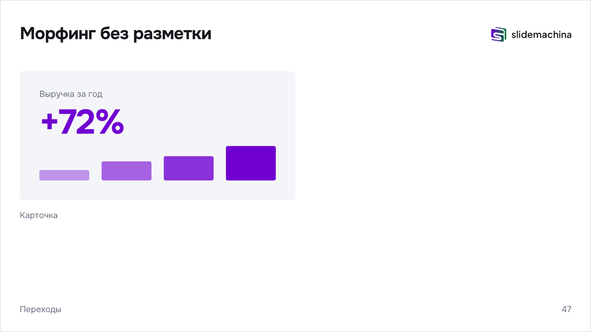
</p>

## Зачем

- **Слайды — компоненты React.** Слайд — JSX, компонент лежит в `index.tsx` рядом с другими. TypeScript подсказывает, git хранит историю, правки идут через ревью.
- **HTML откроется где угодно.** Сборка — один HTML-файл. Открывается с диска в любом браузере, без сети и установки. Ту же сборку можно выложить на сайт.
- **PowerPoint на случай, если HTML нельзя.** `--pptx` даёт редактируемую копию. Текст, код и схемы — отдельные объекты, шаги — анимации по щелчку. Файл открывается в PowerPoint и Google Slides.
- **Агенту удобно.** Вся презентация — один файл с типами. Claude Code и другим агентам легко читать и править. Замечание агенту можно оставить кликом по слайду.

## Быстрый старт

```bash
npm create slidemachina   # спросит: одна презентация или репозиторий докладов
cd my-talk && npm install
npm run dev               # слайды в браузере, правки видны сразу
npm run build             # спросит, что собрать
```

Шаблон — 10 слайдов: обложка, раздел, список по шагам, код, схема, морфинг, картинка на весь слайд.
Все возможности показывает демо: `npm run demo` в этом репозитории.

## Как выглядит презентация

```tsx
import * as Machina from "slidemachina";
import logoPicture from "./images/logo.svg";

export default (
  <Machina.Presentation lang="ru" logo={logoPicture} transition="auto" stepEffect="rise">
    <Machina.Slide cover>
      <h1>Доклад</h1>
    </Machina.Slide>

    <Machina.Section title="Как устроено">
      <Machina.Slide>
        <h2>Три шага</h2>
        <ul data-steps>
          <li>Пункт появляется по нажатию</li>
          <li>Сохранили файл — слайд обновился на том же шаге</li>
        </ul>
      </Machina.Slide>

      <Machina.Slide>
        <h2>Схема</h2>
        <Machina.Diagram>
          <Machina.Box id="browser">Браузер</Machina.Box>
          <Machina.Box id="server">Сервер</Machina.Box>
          <Machina.Arrow from="browser" to="server" label="HTTP" step />
        </Machina.Diagram>
      </Machina.Slide>
    </Machina.Section>
  </Machina.Presentation>
);
```

Раздел даёт обложку с номером, хлебные крошки и группу в обзоре слайдов.
Оформление — обычные теги и классы `machina-…`, тема — CSS-переменные в `style.css`.
Картинки лежат в `images/`, TypeScript подсказывает компоненты и свойства.

## Возможности

<table>
  <tr>
    <td width="50%">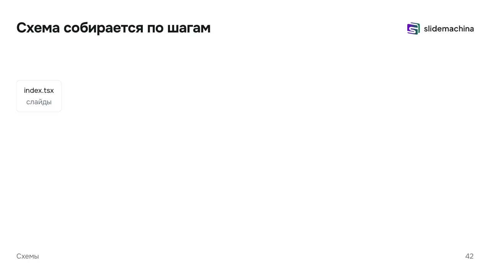</td>
    <td width="50%">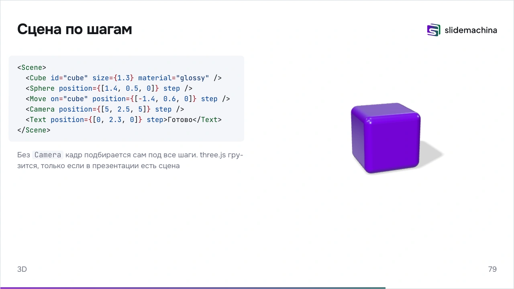</td>
  </tr>
  <tr>
    <td><b>Схемы из тегов.</b> Блок-схемы <code>Diagram</code> и sequence-диаграммы <code>Sequence</code>. Блоки расставляет ELK, появляются по шагам и перетекают между слайдами.</td>
    <td><b>3D-сцены.</b> <code>Scene</code> на three.js. Фигуры, свет и камера — тегами, по шагам. three.js грузится, только если есть сцена.</td>
  </tr>
  <tr>
    <td>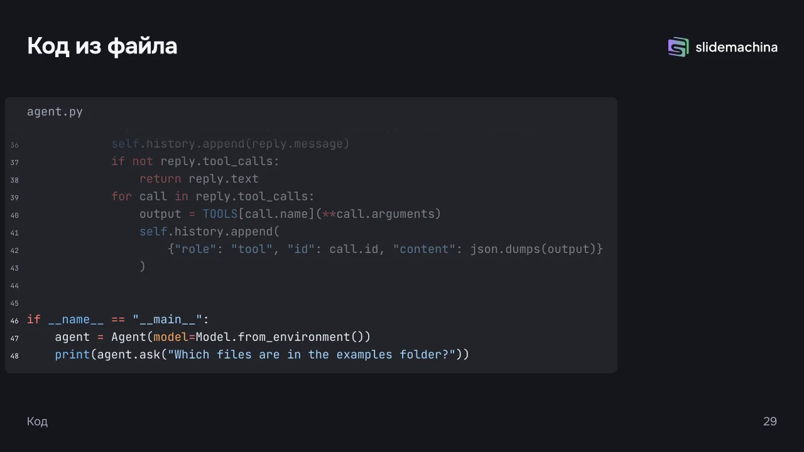</td>
    <td>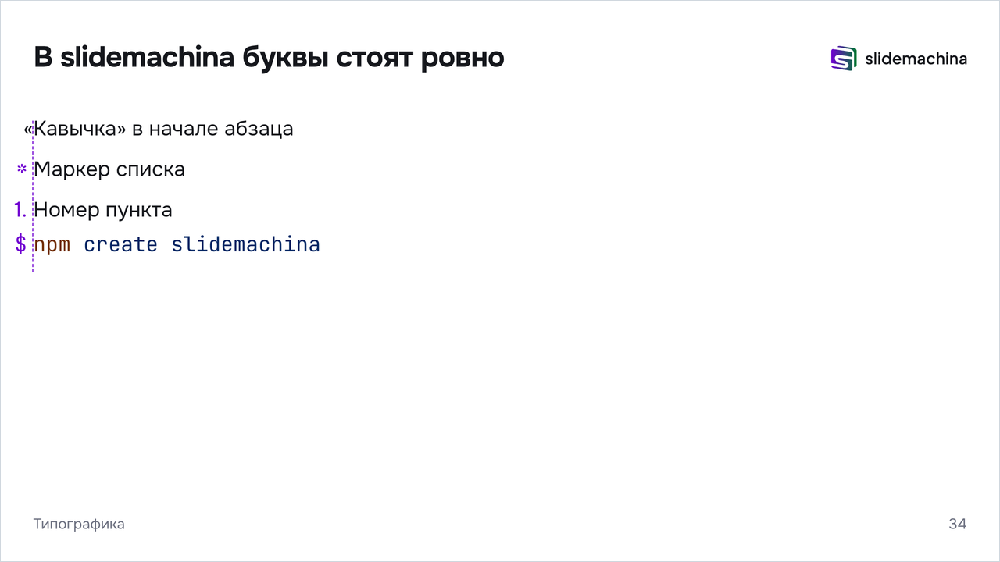</td>
  </tr>
  <tr>
    <td><b>Код.</b> Подсветка Shiki при сборке, её код в браузер не попадает. Код из файла, строки по шагам, морфинг по кускам.</td>
    <td><b>Типограф.</b> Кавычки, тире и неразрывные пробелы для русского и английского. Висячая пунктуация в тексте и коде, в любом браузере и PDF.</td>
  </tr>
  <tr>
    <td></td>
    <td>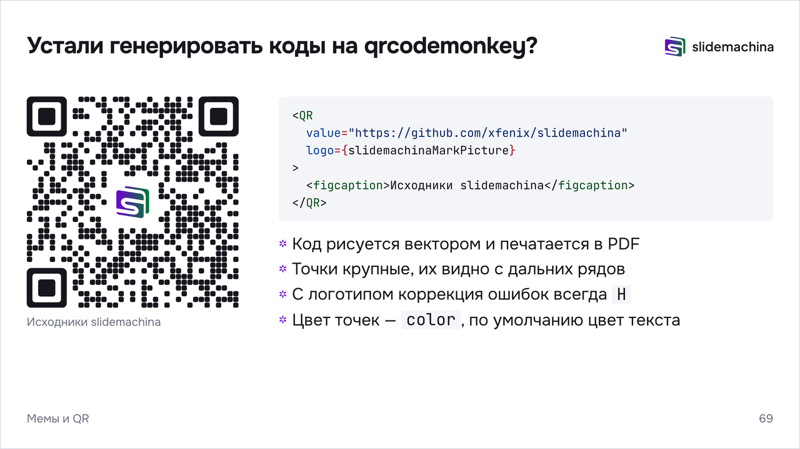</td>
  </tr>
  <tr>
    <td><b>Картинки и видео.</b> На свободное место, на весь слайд или с обтеканием. На тёмном фоне текст и логотип светлеют сами.</td>
    <td><b>QR и мемы.</b> QR-код с логотипом рисуется вектором. Мемы и GIF ищет команда <code>slidemachina meme</code>.</td>
  </tr>
</table>

### Вёрстка

- Разделы и подразделы: обложка с номером «02» и «02.1», хлебные крошки, группы в обзоре. Своя обложка — первый `<Slide cover>` в разделе.
- Обложки с выравниванием по горизонтали и вертикали, с картинкой слева или справа.
- Фон слайда — цвет, картинка, видео, GIF или веб-страница. Тон движок определяет сам.
- Форматы 16:9, 4:3, 16:10, 21:9, 9:16. На экране холст растёт под окно до трети, шрифт не меняется.
- Логотип в пяти местах: справа или слева сверху, сверху по центру, над заголовком, снизу. `plain` прячет логотип, крошки и номер.
- Свободная вёрстка `machina-freeform`, блок поверх `machina-pin`, свой React-компонент с хуками `useSlide()`, `onEnter`, `onLeave`, `onChange`.

### Блоки

- Подзаголовок, примечание, сноска с источником.
- Колонки, большое число с подписью, карточки, столбики графика.
- Таблица и таблица сравнения с галочками и прочерками.
- Цитата с автором, тезис в одну фразу на цветном слайде.
- Картинка и видео: на свободное место, на весь слайд, с обтеканием, `fit="contain"` или `cover`.

### Шаги и переходы

- Шаги на списке, таблице, колонках, части строки, блоках схемы, строках кода и объектах сцены. `data-steps` на списке делает шагом каждый пункт.
- Шесть эффектов шага: `rise`, `fade`, `scale`, `glitch`, `highlight`, `dim`. Один эффект на всю презентацию или слайд — `stepEffect`.
- 13 переходов: `morph`, `slide`, `fade`, `zoom`, `cube`, `flip`, `wipe`, `iris`, `blinds`, `mosaic`, `glitch`, ещё `auto` и `none`. Скорость — на всю презентацию или на слайд.
- Морфинг включён по умолчанию. Пары находятся сами: заголовки, картинки, карточки, числа, столбики, блоки схем, слова в тексте и куски кода.
- При уменьшении движения переходов нет.

### Докладчику

- Окно докладчика по <kbd>P</kbd>: слайд на экране, следующий шаг, заметки к шагам крупным шрифтом, таймер, часы и запас. Листать можно из любого окна, работает и в HTML-файле с диска.
- Обзор слайдов по <kbd>Esc</kbd>, переход по номеру, пауза с чёрным экраном, полный экран, полоса прогресса.
- Скрытые слайды: на сцене их нет, в печати, PDF и PowerPoint они есть. Сюда — подробности и тезисы для копии, которую разошлёте после доклада, и ответы на вопросы из зала.
- Клавиши работают и в русской раскладке, на телефоне листает свайп или касание.

### Сборка

- Один HTML-файл со шрифтами и картинками внутри. В Quick Look на macOS видны снимки слайдов.
- Файл под паролем, папка для сайта, zip.
- PDF по слайду или по шагу на страницу, печатная версия по адресу `?print`.
- PowerPoint с редактируемым текстом, схемами и анимациями шагов.
- Картинки сжимаются в WebP, видео встраивается как есть.

## Инструменты

<table>
  <tr>
    <td width="58%">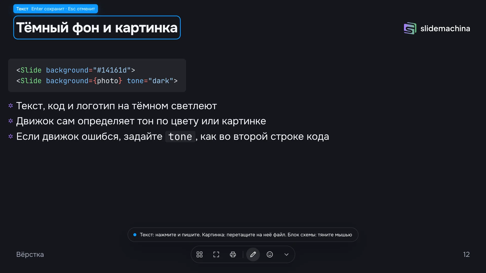</td>
    <td><b>Правка прямо на слайде.</b><br>Нажмите E в <code>slidemachina dev</code>. Текст, картинки, блоки схем и слайды пишутся обратно в <code>index.tsx</code>.</td>
  </tr>
  <tr>
    <td>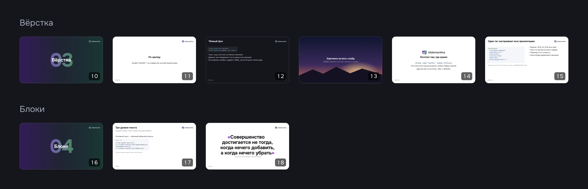</td>
    <td><b>Обзор слайдов.</b><br>Миниатюры по разделам. Esc или O открывает обзор, Enter — выбранный слайд.</td>
  </tr>
  <tr>
    <td>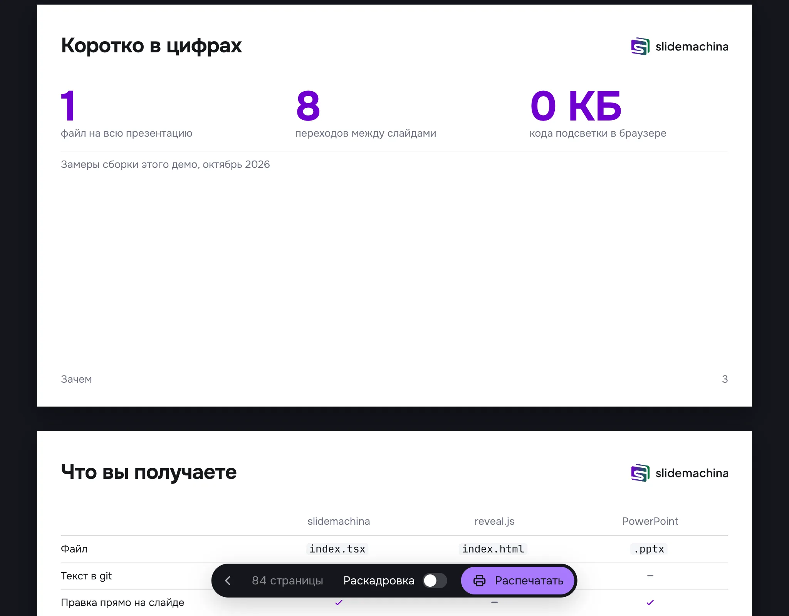</td>
    <td><b>Печать и PDF.</b><br>Страница на слайд или на каждый шаг. <code>slidemachina build --pdf</code> или печать из браузера.</td>
  </tr>
  <tr>
    <td>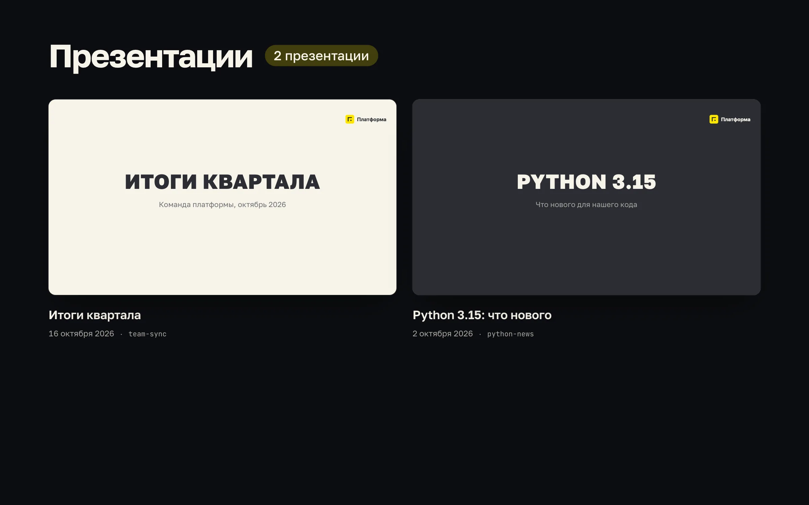</td>
    <td><b>Репозиторий докладов.</b><br>Общая тема, список с живыми обложками по дате, сборка всех презентаций.</td>
  </tr>
</table>

Ещё в `slidemachina dev`:
- мини-карта всех слайдов справа по <kbd>M</kbd>;
- панель «Мем»: шаблоны memegen, GIF из GIPHY или картинка по ссылке. Мем встаёт новым слайдом;
- [Agentation](https://www.npmjs.com/package/agentation): кликните по слайду и напишите замечание, оно уйдёт в Claude Code с местом в файле, например `index.tsx:42:7`;
- правка `.tsx` обновляет слайд без перезагрузки, слайд и шаг остаются.

## Для агентов

Презентацию можно отдать агенту целиком: он пишет слайды, оформляет под бренд и сам проверяет.

- **`AGENTS.md` и скилл в каждом новом проекте.** `npm create slidemachina` кладёт `AGENTS.md`, `CLAUDE.md` и скилл Claude Code `.claude/skills/slidemachina`: как начать доклад, оформить под бренд, проверить.
- **Справочник `llms.txt`.** Все компоненты, классы, шаги, переходы и переменные темы на одной странице: `node_modules/slidemachina/llms.txt`.
- **Правила понятного доклада.** В основе — 12 принципов мультимедийного обучения Ричарда Майера и предел рабочей памяти Миллера 7±2. `slidemachina check` ловит то, что можно измерить: длинные списки, много текста, перегруженные схемы, длинный код без шагов, слайды без заголовка, картинки без `alt`. С `--json` отдаёт место в файле и номер слайда.
- **Снимок слайда.** `slidemachina shot 12.2` сохраняет слайд 12 после двух шагов в PNG: агент видит вёрстку, а не только код.
- **Замечания кликом.** В `slidemachina dev` замечание по слайду уходит в Claude Code через Agentation вместе с местом в файле.

```bash
npx slidemachina check --json   # [{ "file": "index.tsx", "line": 42, "slide": "7", "rule": "longList", … }]
npx slidemachina shot 7         # slide-7.png
```

## Сборка

Без флагов `slidemachina build` спросит, что собрать.
В CI флаги складываются: `slidemachina build --html --folder --pdf --pptx`.

| Флаг | Результат |
|---|---|
| `--html` | Один HTML-файл, шрифты и картинки внутри. Открывается с диска |
| `--protected` | Тот же файл под паролем |
| `--folder`, `--zip` | Папка для сайта или она же в архиве |
| `--pdf`, `--steps` | PDF: страница на слайд или на каждый шаг |
| `--pptx` | PowerPoint. Текст, таблицы, код, картинки, блоки и стрелки схем — отдельные объекты, их можно править. Шаги — анимация по щелчку |
| `--no-hidden` | PDF и PowerPoint без скрытых слайдов. По умолчанию они есть |

## Своя тема

Одна и та же презентация в теме движка и в фирменной теме.
Разметка слайдов не менялась, поменялся только CSS.

<p align="center">
  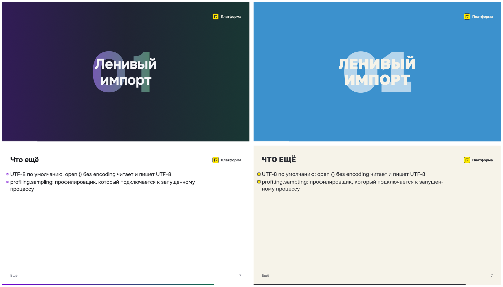
</p>

Тема лежит в `style.css` рядом с `index.tsx`.
Так устроена фирменная тема с картинки, полная версия — [`examples/theme/yellow-brand.css`](examples/theme/yellow-brand.css).

**1. Цвета и фон.** Почти весь вид задают переменные. Поменяли переменную — поменялись все слайды.

```css
@import "tailwindcss";

:root {
  --slide-background: #f6f3e9;   /* фон обычных слайдов */
  --section-background: #fee600; /* фон обложек разделов */
  --dark-background: #2b2d33;    /* фон тёмных слайдов */
  --text-color: #2b2d33;
  --muted-color: #6e6f73;        /* подписи, крошки, номер */
  --accent-color: #2b2d33;       /* маркеры, ссылки, числа */
  --second-accent-color: #2b2d33;
  --code-background: #ece7d8;
}
```

**2. Шрифт.** Файл шрифта кладётся рядом, подключается через `@font-face`.

```css
@font-face {
  font-family: "Golos Text Variable";
  font-weight: 400 900;
  src: url("./fonts/golos-text.woff2") format("woff2-variations");
}

:root {
  --font-text: "Golos Text Variable", system-ui, sans-serif;
  --font-heading: var(--font-text);
  --heading-weight: 800;
}
```

**3. Заголовки и маркеры.** Всё, чего нет в переменных, меняет обычный CSS: он сильнее стилей движка.

```css
[data-slide] :is(h1, h2) {
  text-transform: uppercase;
  letter-spacing: 0.01em;
}

/* Квадратный маркер вместо звёздочки движка */
[data-slide] ul > li:before {
  clip-path: none;
  border-radius: 2px;
  background: #fee600;
  box-shadow: 0 0 0 2px var(--text-color);
}
```

**4. Обложки разделов.** Без градиента и зерна, номер белый.

```css
:root {
  --section-texture: none;
  --section-glow-strength: 0%;
  --section-number-start-color: #ffffff;
  --section-number-end-color: #ffffff;
}
```

**5. Движение, логотип и формат.** Это свойства `Presentation`, их можно переопределить у `Slide`.

```tsx
<Machina.Presentation
  logo={{ light: logoPicture, dark: logoOnDarkPicture }}
  aspectRatio="4:3"
  transition="glitch"
  stepEffect="fade"
  speed="fast"
>
```

**6. Один слайд по-своему.** `className` у `Slide` и классы Tailwind прямо в разметке.

```tsx
<Machina.Slide className="[--hanging-punctuation:0]" background="var(--accent-soft-color)">
  <p className="machina-thesis text-(--accent-color)">Одна мысль крупно</p>
</Machina.Slide>
```

<details>
<summary><b>Все места, где настраивается вид</b></summary>

| Что меняем | Где |
|---|---|
| Цвета | `--accent-color`, `--second-accent-color`, `--text-color`, `--muted-color`, фоны `--slide-background`, `--dark-background`, `--section-background`. У цветов текста есть версии `-on-dark` для тёмных слайдов |
| Шрифты | `--font-text`, `--font-heading`, `--font-code`, `--heading-weight`. Свой шрифт — через `@font-face` в том же `style.css` |
| Размеры шрифта | Четыре уровня: `--secondary-text-size` 28, `--text-size` 40, `--heading-size` 56, `--display-size` 112. Остальные размеры берутся от них |
| Поля и отступы | `--frame-padding` по бокам и снизу, `--frame-top` сверху, `--heading-gap` под заголовком, `--block-gap` между блоками, `--columns-gap` между колонками |
| Маркеры списка | `[data-slide] ul > li:before` и `--list-bullet-indent` |
| Обложки разделов | `--section-background`, `--section-number-start-color`, `--section-number-end-color`, `--section-number-size`, `--section-texture`, `--section-glow-strength`. Или свой `<Slide cover>` первым в разделе |
| Движение | `transition` и `speed` у `Presentation` или `Slide`, длительности `--transition-duration` и соседние, кривая `--transition-easing` |
| Шаги | `stepEffect` у `Presentation` или `Slide`: `rise` (по умолчанию), `fade`, `scale`, `glitch`, `highlight`, `dim`. `data-step-effect` у элемента сильнее |
| Полоса прогресса | `--progress-color`, `--progress-color-on-dark`, `--progress-height`, `progress={false}` у `Presentation` |
| Формат | `<Presentation aspectRatio="4:3">`, по умолчанию `16:9`. Миниатюры, PDF и PowerPoint — в этом формате, на экране слайд растёт под окно до трети |
| Разделитель крошек | `<Presentation breadcrumbsSeparator="/">`, по умолчанию `›` |
| Иконка вкладки | `<Presentation favicon={favicon}>` с `import favicon from "./favicon.svg"`, по умолчанию знак slidemachina |

- Логотип — `logo` у `Presentation`: файл, `{ light, dark }` для светлых и тёмных слайдов или компонент. Компонент получает `dark={true}` на тёмных слайдах. Логотип движка — `logo={Machina.SlidemachinaLogo}`.
- Место логотипа — `logo` у `Slide`: `"top-right"` (по умолчанию), `"top-left"`, `"top"`, `"center"` над заголовком, `"bottom"` или `false`.
- Тёмный слайд — `background` у `Slide`, цвет или картинка. Тон движок определяет сам, ошибку исправляет `tone`.
- Общая тема нескольких докладов — `theme/style.css` в репозитории презентаций. Тема доклада сильнее общей.
- Тема на часть докладов — CSS-файл, который подключают прямо в `index.tsx`: `import "../theme/brand.css"`.

Все переменные с описанием — в разделе «Тема» в [docs/slidemachina.md](docs/slidemachina.md).

</details>

## Сравнение

Другие инструменты помогают сделать красивый слайд.
slidemachina помогает сделать доклад, за которым легко следить. Списки, текст и схемы не выходят за 7±2 Миллера, подача следует 12 принципам мультимедийного обучения Ричарда Майера.

| | slidemachina | reveal.js | Slidev | open-slide |
|---|---|---|---|---|
| Понятный доклад | `check` считает пункты списков, слова, блоки схем, строки кода и разделы. Скилл для агента следует принципам Майера | — | — | Скилл спрашивает, сколько текста на слайде. Проверки нет |
| Разметка | JSX в `index.tsx` с подсказками TypeScript | HTML: `<section>` в `index.html` | Markdown с компонентами Vue | Страницы на React, холст 1920×1080 |
| Разделы | `Section`: обложка с номером, хлебные крошки, группы в обзоре слайдов | Вложенные `<section>` — вертикальные слайды | — | — |
| Шаги | `data-steps` на списке, таблице, колонках, части схемы или сцены. Эффект для всех шагов — одно свойство `stepEffect` | `class="fragment"` на каждом элементе | `v-click` на каждом элементе | `<Step>` вокруг каждого элемента |
| Морфинг | Включён по умолчанию. Общие элементы, слова и куски кода находятся сами | `data-auto-animate` на обоих слайдах, пары через `data-id` | Только код, через `magic-move` | `MorphElement` с одним `id` на обеих страницах |
| Подсветка кода | Shiki при сборке: в браузере 0 КБ кода подсветки. Строки по шагам | highlight.js в браузере | Shiki, правка кода в Monaco | — |
| Схемы | Блок-схемы и sequence-диаграммы из тегов. Блоки расставляет ELK | Mermaid сторонним плагином | Mermaid | — |
| 3D | `Scene` на three.js | — | — | — |
| Типограф | Для русского и английского, висячая пунктуация | — | — | — |
| Сборка | HTML-файл, папка, zip, файл под паролем, PDF, PowerPoint | Сборщик настраиваете сами | Сайт, PDF, PNG, PowerPoint | Сайт, PDF, PowerPoint |
| Правка | В редакторе кода и на слайде, с записью в `index.tsx` | В редакторе кода | В редакторе кода и в панели с Markdown | Комментарии на слайде, их вносит агент |
| Окно докладчика | Заметки, таймер, следующий слайд, следующий шаг, заметки к шагу | Заметки, таймер, следующий слайд | Заметки, таймер, следующий слайд, рисование | Заметки, таймер, следующий слайд |
| Для агентов | `llms.txt`, скилл, `check` с правилами понятного доклада, `shot` со снимком слайда | — | MCP-сервер в `slidev dev` | Скиллы для написания и правки, панель агента в браузере |
| Много докладов | Репозиторий: общая тема, список с обложками, сборка всех сразу | Каждый сам по себе | Темы в пакетах npm | Доклады в одной папке, общие темы |

Прочерк — у инструмента этого нет из коробки.

reveal.js — если нужны его плагины и чистый HTML.
Slidev — если пишете на Markdown и Vue, нужны рисование на слайде и формулы.
open-slide — если слайды пишет агент, а вы только оставляете комментарии.

## Разработка

```bash
npm install
npm run demo     # демо со всеми возможностями
npm run check    # TypeScript, Oxlint и границы модулей
npm test         # интеграционные тесты на Playwright
```

Устройство движка, решения и ограничения — в [docs/slidemachina.md](docs/slidemachina.md).
Правила для кода — в [AGENTS.md](AGENTS.md).

## Лицензия

[MIT](LICENSE)
